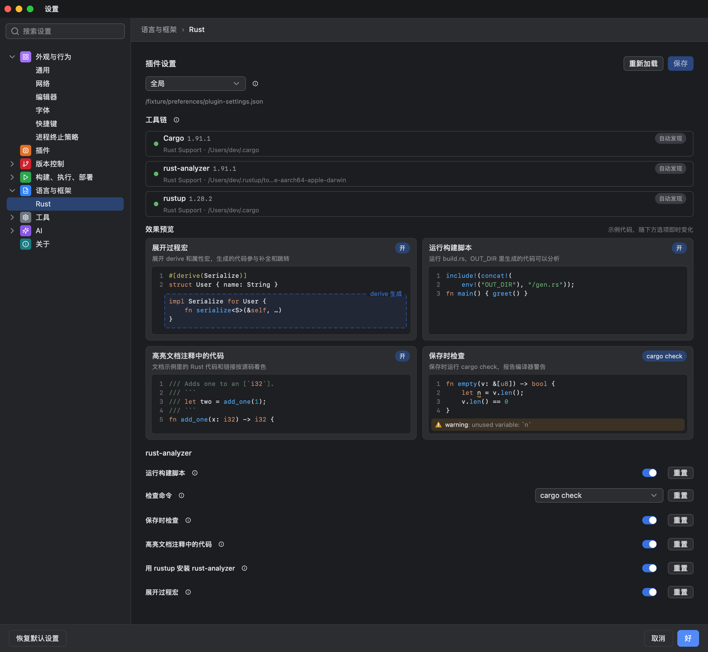
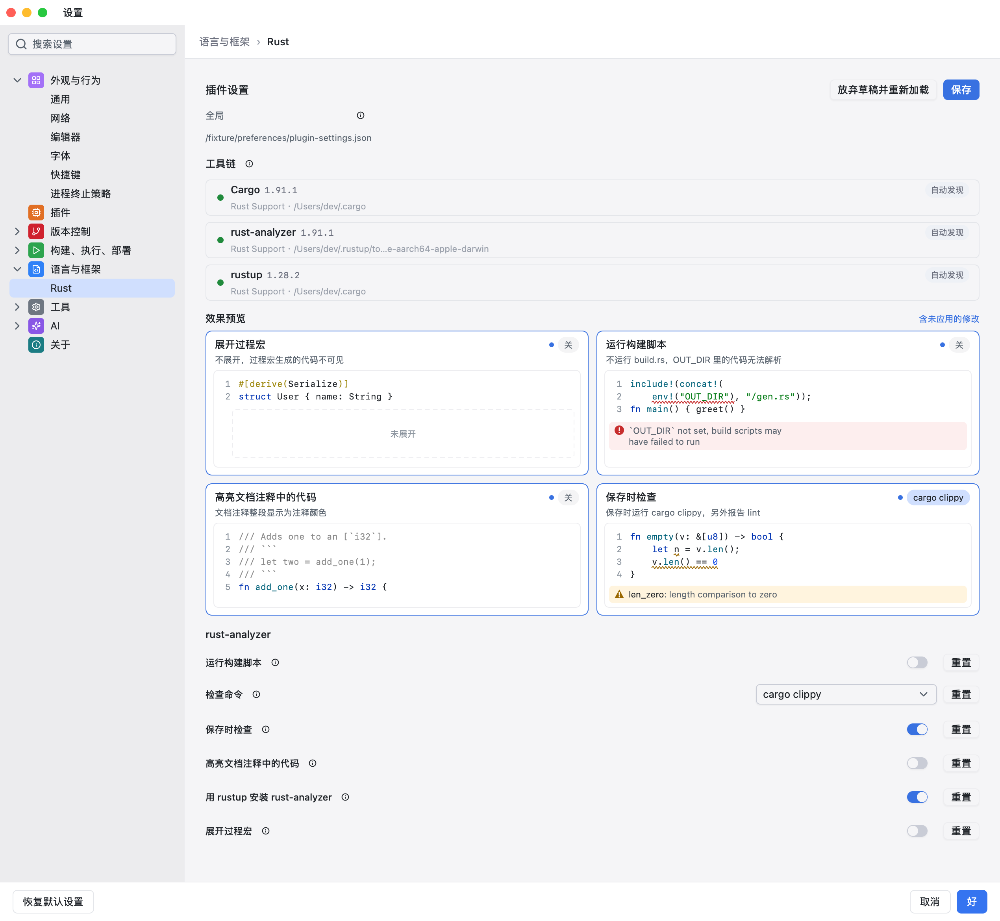
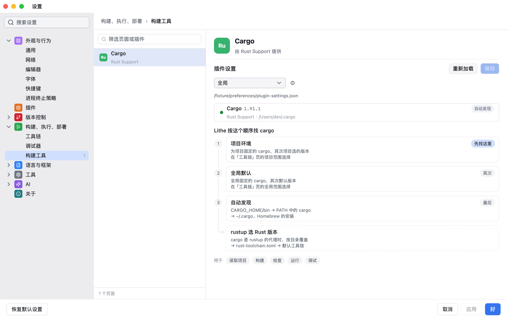

# Rust Support for Lithe

为 [Lithe](https://github.com/1lck/Lithe-IDEA) 提供 Rust 支持：rust-analyzer 代码智能；构建窗口里的 Cargo 软件包和目标，
可以 Build、Check、Clippy、Doc、Clean、运行，并查看依赖树；CodeLLDB 调试；在「新建项目」里创建 Cargo 软件包；设置页画出各项设置的效果预览。
这是一个**社区插件**，按插件契约 v0 编写，由 `plugin.json`、项目模板和一个用 Rust SDK 写的后端组成。
cargo、rustup 和 rust-analyzer 用你电脑上的，CodeLLDB 在第一次调试前由 Lithe 下载。

> English: Rust support for Lithe — rust-analyzer code intelligence, Cargo packages in the build window (Build,
> Check, Clippy, Doc, Clean, run, dependency tree), CodeLLDB debugging, a Cargo package entry in New Project and
> previews on the Rust and Cargo settings pages. cargo, rustup and rust-analyzer stay your own; Lithe downloads
> CodeLLDB the first time you debug.

> **兼容性**：需要 Lithe 桌面端 0.8.12 或更新版本（`desktop-v*`），旧版 macOS Lithe 无法安装。
> 各版本依赖的宿主能力见 [docs/releases](docs/releases)。

本插件取代 `lithe-plugin-cargo`。两个插件都声明了 `cargo` 构建系统，不要同时启用。

## 功能

| 功能 | 说明 |
| --- | --- |
| 代码智能 | 补全、跳转定义、悬停、诊断、格式化，由 `rust-analyzer` 提供；保存时运行 `cargo check` 或 `cargo clippy`，结果显示为诊断 |
| 识别软件包 | 含 `Cargo.toml` 的最外层目录是构建根；`cargo metadata --no-deps` 的结果组成软件包和目标，只读清单，不联网 |
| 构建 | Build、Check、Clippy 作用于工作区、软件包或单个目标；Doc（`--no-deps`）和 Clean 作用于工作区或软件包 |
| 运行 | 每个二进制和示例在构建窗口里有运行按钮（`cargo run --bin` / `--example`）；编辑器打开 `src/main.rs`、`src/bin/*.rs`、`examples/*.rs` 时也有运行入口 |
| 诊断 | 构建输出里 `文件:行:列: error|warning: 消息` 形式的内容显示为问题 |
| 依赖 | 按 `cargo tree` 的样子列出依赖图；同一个软件包再次出现时不展开 |
| 同步 | `Cargo.toml`、`Cargo.lock`、`.cargo/config(.toml)`、`rust-toolchain(.toml)` 变化后重新读取 |
| 调试 | 二进制和示例的「调试」：先构建，再用 CodeLLDB 启动，支持断点、单步、调用栈、变量 |
| 新建项目 | 选择 Cargo，选二进制或库，生成 `Cargo.toml`、`.gitignore` 和 `src/main.rs` 或 `src/lib.rs` |
| 工具链 | 找到电脑上的 cargo、rustup 和 rust-analyzer；项目可以固定用其中一个 Cargo |
| 设置预览 | Rust 语言页和 Cargo 构建工具页画出设置的效果，见下文“设置预览” |

## 设置和构建选项

**插件设置**（设置 → 插件 → Rust Support →「设置」，也显示在「语言与框架 › Rust」页），开关默认都开启：

| 设置 | 生效 | 说明 |
| --- | --- | --- |
| Check on save | 立即 | 保存 Rust 文件时运行 Cargo 检查（`checkOnSave`） |
| Check command | 立即 | 用 `cargo check`（默认）还是 `cargo clippy`；Clippy 多报告 lint，耗时更长（`check.command`） |
| Expand procedural macros | 语言服务器下次启动 | 展开 `derive(Serialize)`、`#[tokio::main]` 等过程宏，生成的代码才能补全和跳转；开启时也会运行构建脚本（`procMacro.enable`） |
| Run build scripts | 语言服务器下次启动 | 运行 `build.rs`，分析它生成到 `OUT_DIR` 的代码和设置的 cfg（`cargo.buildScripts.enable`） |
| Highlight code in doc comments | 立即 | 高亮文档注释里的 Rust 代码和条目链接（`semanticHighlighting.doc.comment.inject.enable`） |
| Install rust-analyzer with rustup | 语言服务器下次启动 | 工具链缺 rust-analyzer 时先运行 `rustup component add rust-analyzer rust-src`，需要联网 |

括号里是对应的 rust-analyzer 配置。

**构建选项**（构建窗口 →「构建选项」），只对当前工作区生效，加到构建、检查、Clippy、Doc、运行和调试的命令里，Clean 只看 Release Profile：

| 选项 | 传给 cargo 的内容 |
| --- | --- |
| Release Profile | `--release`，输出到 `target/release` |
| Features | 按软件包选中的特性，只传给所构建的软件包（`--features`） |
| All Features | `--all-features`，忽略上面选择的特性 |
| No Default Features | `--no-default-features` |
| Offline | `--offline` |

**工具链**（设置 →「构建、执行、部署」→「工具链」）：Lithe 在 `~/.cargo` 和 Homebrew（Linux 上是 Linuxbrew）里查找 cargo、
rustup 和 rust-analyzer，用 `--version` 读出版本。构建用的 Cargo 依次取：项目固定的、全局默认的、`CARGO_HOME/bin/cargo`、
`PATH` 里的 `cargo`、找到的安装。选中的 Cargo 所在的 `bin` 目录加到命令的 `PATH` 前面。

## 设置预览

两块预览由插件后端按界面语言、外观和设置窗口宽度画出。它们用示例代码，不读取打开的项目；截图里的路径和版本是测试数据。

**语言与框架 › Rust**：顶部列出 Lithe 用的 cargo、rust-analyzer 和 rustup，点一行到「工具链」页更换。下面四张卡片各对应一项设置：

| 卡片 | 开启时 | 关闭时 |
| --- | --- | --- |
| 展开过程宏 | `#[derive(Serialize)]` 下面画出生成的 `impl Serialize` | 显示“未展开” |
| 运行构建脚本 | `include!(concat!(env!("OUT_DIR"), …))` 正常解析 | 标出 `` `OUT_DIR` not set `` |
| 高亮文档注释中的代码 | 注释里的代码和 `` [`i32`] `` 链接按源码着色 | 整段是注释颜色 |
| 保存时检查 | `cargo check` 报告未使用变量；`cargo clippy` 另外报告 `len_zero` | 只有 rust-analyzer 自己的诊断 |



还没应用的修改先画进预览：改动的卡片换成强调色边框，值前加圆点，右上角标出“含未应用的修改”。
下图关掉了三个开关、把检查命令改成 `cargo clippy`：



**构建工具 › Cargo**：画出 Lithe 查找 cargo 的三步（项目环境、全局默认、自动发现）、rustup 选 Rust 版本的顺序，
以及 cargo 用在哪些流程。这一页没有设置项，换 cargo 要到「工具链」页。



## rust-analyzer

每次启动 rust-analyzer 前，Lithe 都问插件后端怎样启动（`rustAnalyzer.launch`），所以它跟着项目的工具链走：

| Lithe 找到的 | 怎样启动 |
| --- | --- |
| 不是 rustup 代理的 rust-analyzer（设置里选的或单独安装的） | 直接启动，`CARGO` 设为构建系统用的 Cargo |
| rustup | `rustup run <项目的工具链> rust-analyzer`；缺少组件时先装上它和 rust-src（可在设置里关闭） |
| 只有 rust-analyzer 的 rustup 代理 | 启动这个代理 |
| 都没有 | 报错，提示怎样安装 |

rustup 运行时带 `RUSTUP_AUTO_INSTALL=0`，不会顺便安装工具链；项目要求的工具链没装时，错误信息给出安装命令。
工具链放在项目目录里时它属于项目代码，插件不启动它的 rust-analyzer。

## 调试

构建窗口里二进制或示例的「调试」会先用 `cargo build` 构建这个目标（带上构建选项），再让 CodeLLDB 启动程序。

- 工作目录是软件包所在目录，参数和环境变量和运行时相同；变量按 Rust 类型显示；程序结束后会话自动结束，输出留在调试控制台。
- 只支持启动调试，不支持附加到进程，也不支持调试测试。
- 从符号链接路径打开项目时（如 macOS 的 `/tmp`），断点不会停下：调试信息里记的是真实路径。请从真实路径打开项目。

**CodeLLDB 不在插件包里。** 第一次调试前，在 **设置 → 插件 → 已安装 → Rust Support → 功能** 的调试卡片上点 **安装**。
Lithe 从 [vadimcn/codelldb 1.12.3](https://github.com/vadimcn/codelldb/releases/tag/v1.12.3) 下载对应平台的 VSIX
（Apple Silicon 约 45 MB），核对清单里的 SHA-256，解压到插件的状态目录；卸载插件时一起删除。

| 平台 | CodeLLDB 包 |
| --- | --- |
| macOS Apple Silicon / Intel | `codelldb-darwin-arm64.vsix` / `codelldb-darwin-x64.vsix` |
| Windows x64 | `codelldb-win32-x64.vsix` |
| Linux x64 / ARM64 | `codelldb-linux-x64.vsix` / `codelldb-linux-arm64.vsix` |

CodeLLDB 1.12.3 没有 Windows ARM64 的包，那里不能调试，其他功能可用。也可以把自己的 `codelldb` 放进 `PATH`，Lithe 会直接用它。

## 新建项目

「新建项目」对话框左侧选 **Rust**：

| 字段 | 说明 |
| --- | --- |
| Cargo | 从「工具链」找到的安装里选，创建后项目固定使用它（`.lithe/toolchains/local.json`）；没找到时留空，不影响创建 |
| Crate | Binary（默认）生成打印 `Hello, Rustacean!` 的 `src/main.rs`；Library 生成带一个测试的 `src/lib.rs` |
| Package name | `Cargo.toml` 的 `name`，默认是小写的项目名；只能用字母、数字、`-` 和 `_`，以字母开头 |
| Edition（高级） | 2024（默认，需要 Rust 1.85+）或 2021 |

文件由模板直接写出，不运行 `cargo new`，不需要联网，也不需要先装好 cargo；`.gitignore` 忽略 `/target`。
这些字段目前只有英文名称：插件语言文件还不能翻译新建项目的字段。

## 依赖的程序

| 程序 | 用途 | 查找方式 |
| --- | --- | --- |
| `cargo` | 读取软件包、构建、检查、运行、依赖、调试前构建 | 「工具链」选出的 Cargo，最后找 `PATH` |
| `rustup` | 选项目的工具链、启动和安装 rust-analyzer | 「工具链」选出的 rustup，最后找 `PATH` |
| `rust-analyzer` | 代码智能 | 见上文“rust-analyzer” |
| `codelldb`（1.12.3） | 调试 | 先找在 Lithe 里安装的，再找 `PATH` |

cargo 和 rustup 需要自己安装，推荐用 [rustup](https://rustup.rs)。安装插件时 Lithe 会列出这些程序和插件需要的权限，确认后才安装。

## 安装

1. 从 [Releases](https://github.com/Lithe-IDEA/lithe-plugin-rust/releases) 下载对应平台的包：macOS 用 `rust-support-<版本>-darwin.zip`（Apple Silicon 和 Intel 通用），
   Windows 用 `rust-support-<版本>-windows-x64.zip` 或 `rust-support-<版本>-windows-arm64.zip`。
2. 在 Lithe 的 **设置 → 插件** 里点标题栏右侧的 **从文件安装…**，选中 zip，核对 SHA-256 和权限后确认。
3. 打开含 `Cargo.toml` 的项目：构建窗口出现 Cargo，打开 `.rs` 文件时启动 rust-analyzer。

## 工作方式

- 后端用 [Rust 插件 SDK](https://github.com/Lithe-IDEA/Lithe-core-rust/tree/main/shared/plugins/sdk/rust) 编写，
  Lithe 按两种身份启动它：插件后端回答 `rustAnalyzer.launch` 和 `settings.view`；Cargo 构建提供者回答
  `lithe/build/model`、`dependencies`、`execute`、`prepareRun`、`prepareDebug` 和 `runEntrypoints`。
- 后端不保存状态，也不写文件，每次请求都重新问 Cargo 或 rustup。Cargo 只写项目的 target 目录，rustup 只写它自己的工具链。
- 设置预览由两个 `settingRegions`（`language`、`cargo`）声明，`settings.view` 按发来的语言、宽度、已保存设置和草稿画出画布，只读不写。
- rust-analyzer 按 `languageServers` 的声明启动，插件设置通过 `workspaceConfiguration` 里的 `${setting:<id>}` 传给它。
- 调试时后端先构建，Lithe 再按 `debugAdapters` 的声明启动 CodeLLDB（`stdio` 传输）；CodeLLDB 按 `commandInstallers` 的 `download` 声明下载。
- 新建项目由 `projectGenerators` 声明，模板在 `templates/rust/`，以 `dot-` 开头的文件生成为点文件。
- 插件目录在运行时保持只读。

## 诊断日志

后端用 Rust SDK 接入 Lithe 的日志协议，SDK 自动记录每次请求的成败（编辑器打开 Rust 文件时询问运行入口的成功不记录）。
插件只在真的降级时上报一次 WARN：

| 类别 | 什么时候 |
| --- | --- |
| `cargo.membersOutsideFolder` | 工作区有成员在打开的文件夹之外，模型里不列出它们 |
| `cargo.dependencyTreeTruncated` | 依赖树超过 Core 的上限，后面的依赖没有列出 |
| `cargo.outputTruncated` | 构建输出超过 Core 保留的 32 MiB，最终结果被截断（构建输出窗口里仍完整） |
| `rust.noWorkspaceFolder` | 启动 rust-analyzer 时没有工作区文件夹，按 rustup 的默认工具链启动 |
| `rust.rustSrcMissing` | rust-analyzer 装上了，但 rust-src 没装上，标准库的跳转和补全不可用 |

rust-analyzer 和 CodeLLDB 的启动结果由 Lithe 记在插件的日志通道；rust-analyzer 的 `window/logMessage` 和有界的 stderr
进语言服务日志。CodeLLDB、被调试程序和 cargo 的输出只显示在调试控制台或构建输出里，不进诊断日志。

## 本地打包

需要 Rust 工具链和对应的 target（`rustup target add`）、Node.js 22+ 和 `zip`。macOS 上构建 darwin（通用二进制，ad-hoc 签名），
Windows 上构建 windows-x64 和 windows-arm64：

```bash
(cd backend && cargo test --locked)            # 后端单元测试
node scripts/build-backend.mjs darwin          # 写到 .artifacts/backend-darwin/
node scripts/package.mjs --platforms darwin    # CI 和发布时三个平台都打
node --test scripts/package/*.test.mjs         # 核对 dist/ 里的每个包
```

输出 `dist/rust-support-<版本>-<平台>.zip` 和 SHA-256。包里有后端程序和后端所用 crate 的 `THIRD_PARTY_LICENSES.txt`，
不带 CodeLLDB。`plugin.json` 的格式见 Rust Core 仓库的
[插件契约](https://github.com/Lithe-IDEA/Lithe-core-rust/blob/main/shared/plugins/contract/v1/README.md)、
[构建工具接入指南](https://github.com/Lithe-IDEA/Lithe-core-rust/blob/main/shared/plugins/guides/build-tool-integration.md)
和[语言服务器插件生命周期](https://github.com/Lithe-IDEA/Lithe-core-rust/blob/main/shared/plugins/guides/lsp-plugin-lifecycle.md)。

## 宿主端到端测试

`e2e/host/` 里的测试用 Lithe 桌面端自己的测试工具安装真实插件包，操作构建窗口、编辑器、调试窗口和设置页的预览。
`e2e/host/lithe-host.json` 记录测试最后一次通过时的宿主版本，主仓库不读取本仓库。

需要 Node.js 22+、Go、Rust 工具链、`git`，以及装好 rust-analyzer 组件的 rustup（测试不会替你安装）；调试测试会联网下载 CodeLLDB：

```bash
node scripts/build-backend.mjs darwin
node scripts/package.mjs --platforms darwin
LITHE_TEST_RUST_PLUGIN_ARCHIVE="$PWD/dist/rust-support-0.1.1-darwin.zip" node scripts/e2e-host.mjs
```

插件包路径要写绝对路径。脚本把固定版本的宿主检出到 `.artifacts/lithe-host`，复制 `e2e/host/desktop/` 下的测试后运行；
第一次会克隆并构建 Rust Core，`LITHE_CORE_RUST_DIR` 可以指向本地的 Core 检出。`--source <本地 Lithe 检出>`、
`--ref <分支或 commit>`、`--run <正则>` 分别换宿主来源、换宿主版本、只跑部分测试。升级 `revision` 时可能要同步修改测试。

## 功能矩阵

各项能力在 macOS 和 Windows 上的实现与验收状态见 [docs/feature-matrix.md](docs/feature-matrix.md)，改动插件行为时在同一个 PR 里更新它。

## 发布新版本

1. 同时修改 `io.github.lithe-idea.rust-support/plugin.json` 和 `backend/Cargo.toml` 的 `version`：修复升修订号，加功能升次版本号，
   特别大的革新才升主版本号。依赖还没发布的宿主能力时照样升次版本号，作为预发布版本发布。合入 `main`。
2. 推送同名标签，例如 `git tag v0.1.1 && git push origin v0.1.1`。
3. `Release` 工作流核对标签与版本、打包并发布 Release，说明里附 SHA-256 和 `docs/releases/v<版本>.md`。
   `release.yml` 的 `PRERELEASE_TAGS` 里的版本标为预发布，目前只有 `v0.1.0`。
4. Lithe Store 的自动追踪会为稳定版本开合并请求，合并后用户即可更新。预发布版本要收录时，在 Store 中手工提交条目，
   并使用已发布 ZIP 的实际 SHA-256。

## 许可

[Apache-2.0](LICENSE)。CodeLLDB 以 MIT 许可发布，由 Lithe 从它的发布页下载，不随插件分发。
